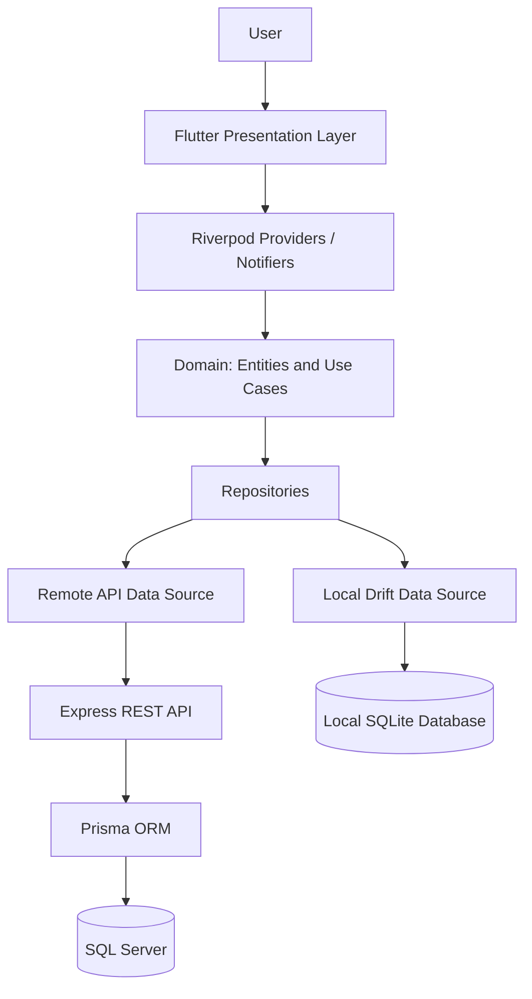
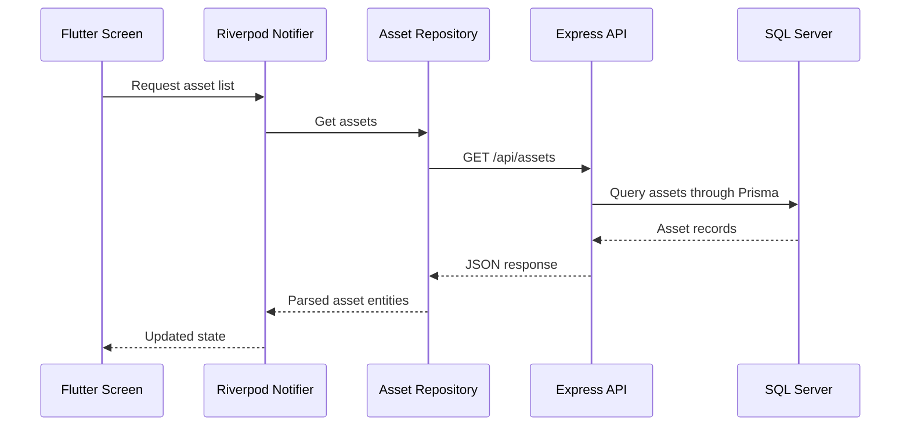
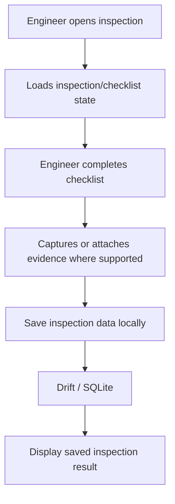

# Architecture Documentation
## FLUTTER-005 — Enterprise Augmented Reality (AR) Asset Inspection & Maintenance Platform

**Submission type:** Individual  
**Client application:** Flutter  
**Backend:** Node.js / Express / Prisma  
**Database:** SQL Server (remote asset API) and Drift/SQLite (local application data)

---

## 1. Purpose and Scope

This document describes the architecture of the Flutter-005 asset inspection and maintenance application. The solution is organized into feature modules and follows Clean Architecture-inspired separation between presentation, domain, and data responsibilities.

The documentation reflects the implementation reviewed for this submission. It does not claim that every requirement in the original case study has been implemented.

## 2. High-Level Architecture

The application is divided into three main areas:

1. **Presentation layer** — Flutter screens, widgets, and Riverpod providers/notifiers. It displays data, collects user input, and reacts to application state.
2. **Domain layer** — feature entities and use cases. It represents business concepts and operations independently of the UI.
3. **Data layer** — repositories, data sources, API clients, and local persistence. It retrieves and stores application data.

The backend is a separate Express API. The Flutter asset feature communicates with it over HTTP. The backend uses Prisma to access SQL Server.



## 3. Feature Module Structure

The reviewed `lib` directory is organized into these feature areas:

```text
lib/
  authentication/
  assets/
  inspection/
  ar_inspection/
  maintenance/
  offline_sync/
  dashboard/
  notifications/
  [shared/core files, as present in the project]
```

Each feature should keep its own presentation, domain, and data responsibilities where those layers are implemented. The exact subfolders can vary by feature.

### Feature responsibilities

| Feature | Responsibility | Current implementation status |
|---|---|---|
| Authentication | Engineer sign-in/session flow | Mock/local session; production JWT and biometric authentication are not implemented |
| Assets | View, add, edit, and delete assets | Connected to Express API and SQL Server; CRUD was tested |
| Inspection | Inspection checklist and evidence workflow | Implemented with local persistence |
| AR Inspection | Guided inspection steps and asset-related guidance | Guided AR-style workflow; not a live ARCore/ARKit scene |
| Maintenance | Maintenance records and related workflow | Local Drift persistence |
| Offline Sync | Local sync queue and status handling | Queue/status functionality; automatic background server synchronization is not verified |
| Dashboard | Summary information | Basic summary counts |
| Notifications | Sample notifications and read state | Sample/in-memory behavior; no Firebase Cloud Messaging integration |
| Analytics | Business analytics | No dedicated implemented module identified in the reviewed source |
| Defects / Spare Parts | Defect and spare-part workflows | No dedicated implemented modules identified in the reviewed source |

## 4. State Management

The application uses **Riverpod** for state management. Providers expose feature state to the UI, while notifiers coordinate actions and state changes.

Typical flow:

1. A screen reads a provider.
2. The user performs an action, such as saving an asset.
3. The notifier invokes the relevant use case or repository operation.
4. The repository calls the appropriate data source.
5. The resulting data or error is reflected in provider state.
6. The UI rebuilds based on the updated state.

This keeps UI code separate from data access and business operations.

## 5. Data Storage and API Integration

### 5.1 Remote asset storage

The asset feature uses an HTTP client to communicate with the Express backend. The configured development API base URL used during testing was:

```text
http://localhost:3000/api
```

The backend exposes these asset endpoints:

| Method | Endpoint | Purpose |
|---|---|---|
| GET | `/api/health` | API health check |
| GET | `/api/assets` | Retrieve assets |
| GET | `/api/assets/:id` | Retrieve one asset |
| POST | `/api/assets` | Create an asset |
| PUT | `/api/assets/:id` | Update an asset |
| DELETE | `/api/assets/:id` | Delete an asset |

The backend uses Express for HTTP routing, Prisma as its ORM, and SQL Server for persistent asset records.

**Environment note:** `localhost` is suitable for local development when the API and client environment can reach one another. For a physical Android device, configure a reachable host address and suitable network/security settings. Do not commit database passwords, API secrets, or a real `.env` file to source control.

### 5.2 Local persistence

Drift provides local SQLite persistence for application data used by inspection-related and other local workflows. Local persistence supports retaining data on the device, but it should not be described as a complete offline-first synchronization system unless background upload, retry, conflict handling, and server reconciliation are implemented and tested.

### 5.3 Data responsibility boundaries

- Asset CRUD is handled by the remote Express API and SQL Server.
- Inspection, AR inspection result, and maintenance data use local Drift persistence in the reviewed implementation.
- The offline-sync feature maintains local queue/status behavior; automatic background synchronization to remote endpoints is not verified.
- Notifications are sample/in-memory rather than remotely delivered.

## 6. Backend Architecture

The backend is a separate Node.js application:

```text
ar_asset_inspection_api/
  server.js
  prisma/
    schema.prisma
  package.json
  [environment configuration kept private]
```

The Express server handles HTTP requests, Prisma maps application operations to SQL Server, and the Asset model stores asset information such as name, asset code, location, and status.

The backend currently provides asset endpoints. Authentication, inspection submission, maintenance, defects, spare parts, and analytics APIs were not identified in the reviewed backend package.

## 7. Main Data Flows

### 7.1 Asset retrieval



### 7.2 Local inspection workflow



This flow describes local persistence. It does not imply that the inspection is automatically uploaded to a remote server.

## 8. Security and Configuration

The reviewed authentication flow uses a mock/local engineer session. It is suitable for demonstrating navigation and UI behavior, but it is not production authentication.

The following production controls remain future work unless separately implemented and tested:

- JWT-based authentication and server-side authorization.
- Secure token storage and refresh/revocation handling.
- Biometric authentication and secure device registration.
- Encryption and access controls appropriate to locally stored sensitive data.
- HTTPS configuration and production secret management.
- Role-based access control on backend endpoints.

Never include real credentials, connection strings, signing keys, or private tokens in the submitted source package.

## 9. Build and Runtime Environment

The project was developed with the following environment:

- Flutter 3.41.9 stable
- Dart 3.11.5
- Riverpod 3.3.2
- Drift 2.32.1
- Node.js 20.15.0
- Express and Prisma 6.19
- SQL Server 2022 Express

The Flutter client was tested in Chrome during development. Android build configuration is present, but the final release APK must be built and tested on the target Android environment before submission.

For local API testing, start the backend from its project directory using the command confirmed for this project:

```bash
node server.js
```

Then run the Flutter app using the appropriate configured target. Confirm the API base URL is reachable from that target.

## 10. Known Limitations and Future Enhancements

The original case study describes a broader enterprise solution than the current implementation. The following items should be treated as future enhancements unless additional implementation and test evidence is supplied:

- Real ARCore/ARKit tracking and 3D component overlays.
- QR/barcode, NFC, image-based asset recognition.
- Production authentication, JWT, biometrics, and secure device registration.
- Voice notes, video evidence, digital signatures, and photo annotation.
- Spare-parts inventory and replacement guidance.
- Defect tracking and repair recommendations.
- Background synchronization, retry policies, conflict resolution, and remote inspection APIs.
- Push notifications through FCM and local notification scheduling.
- Analytics dashboards for failure trends, cost, downtime, and engineer performance.
- Geolocation and production deployment configuration.

These limitations are recorded to make the architecture and submission status transparent.

## 11. Validation Performed

The following development checks were reported during implementation:

- Flutter app launched and exercised in Chrome.
- Asset create, read, update, and delete operations were tested through the backend.
- SQL Server records were checked after asset creation, update, and deletion.
- Inspection and AR-guided inspection results were checked for local persistence across browser refresh.
- `flutter analyze` completed with **No issues found** at the time of the reported check.

Re-run analysis and the relevant manual tests on the exact final source package before submitting.

## 12. Individual Submission Note

This project is being submitted individually. The architecture and implementation statements in this document describe the work reviewed for the individual submission; no second engineer or unverified contribution is claimed.
